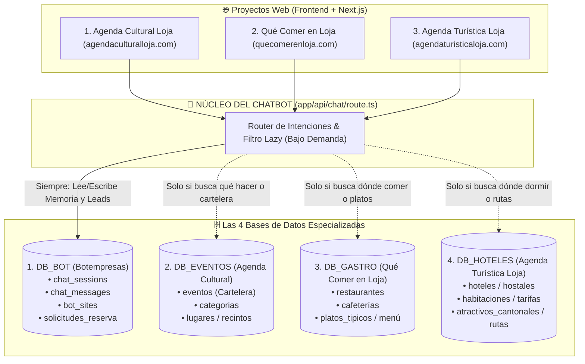

# 🤖 Arquitectura y Documentación Maestra del Bot Multisite (4 Bases de Datos)

Este documento detalla la arquitectura completa, el estado actual del bot y la hoja de ruta técnica para conectar las **4 bases de datos** en los 3 proyectos hermanos de Loja (`agendaculturalloja.com`, `quecomerenloja.com`, `agendaturisticaloja.com`).

---

## 1. Estado Actual del Bot: ¿Está Listo?

**SÍ, el bot actual ya está completamente listo, optimizado y operativo:**
1. **Separación de Base de Datos Realizada:**
   - La base de datos central del bot (`Botempresas-353039368f96` en puerto `44521`) ya almacena sesiones, memoria, mensajes e intenciones con el campo `siteId`.
   - El cliente Prisma del bot (`lib/prisma-bot.ts`) y su schema (`prisma/schema-bot.prisma`) están aislados e independientes.
2. **UI & Experiencia de Usuario Pulida:**
   - **Auto-scroll no invasivo:** El bot no empuja al usuario al fondo si está leyendo mensajes previos hacia arriba.
   - **Tipeo ágil:** Efecto streaming rápido y fluido.
   - **Sugerencias con botón de cierre (✕):** Descartables cuando el usuario no las necesita.
   - **Geolocalización GPS activa:** Con botón `🔄 Actualizar` para refrescar barrio/zona en tiempo real.
   - **Secciones de aliados segmentadas:** Hoteles y Restaurantes separados en bloques visuales independientes con sus propios badges (`🏨 Hotel`, `🍽️ Resto`, `☕ Café`) y botones de interacción.
   - **Embudo de Venta Interactivo (5 pasos):** Conexión directa a WhatsApp con mensajes pre-redactados para reservas.

---

## 2. Mapa de las 4 Bases de Datos

---

## 3. Rol de Cada Base de Datos y Estructura de Datos

### 🗄️ 1. Base de Datos Central del Bot (`CHATBOT_DB_URL`)
* **Nombre de DB:** `Botempresas-353039368f96`
* **Host:** `mysql.us.stackcp.com:44521`
* **Propósito:** Cerebro conversacional común y CRM de prospectos.
* **Tablas principales:**
  * `bot_sites`: Catálogo de los 3 sitios autorizados (`agenda-cultural-loja`, `quecomerenloja`, `agendaturisticaloja`).
  * `chat_sessions`: Guarda `sessionId`, `siteId`, datos de GPS (`zonaDetectada`, `lat`, `lng`), nombre del visitante (`nombreUsuario`) y resumen de memoria (`contextoResumen`).
  * `chat_messages`: Registra la conversación con marcas de tiempo y arrays JSON de IDs recomendados (`eventosIds`, `aliadosIds`, `atractivosIds`).
  * `solicitudes_reserva`: Registro unificado de leads y solicitudes de reserva comercial.

---

### 🗄️ 2. Base de Datos de Eventos (`DB_EVENTOS_URL`)
* **Sitio Propietario:** Agenda Cultural Loja
* **Propósito:** Cartelera cultural viva del cantón Loja.
* **Datos que el Bot extrae:**
  * `eventos`: Título, fecha y hora exacta (`America/Guayaquil`), recinto/lugar, descripción, slug de enlace web (`/eventos/[slug]`), fotos.
  * Filtros de consulta del bot:
    * Por fecha: Hoy, mañana, este fin de semana, rangos de fecha específicos.
    * Por temática: Rock, teatro, danza, arte, infantil, ferias, exposiciones.
    * Estado: Exclusivamente eventos en estado `APROBADO`.

---

### 🗄️ 3. Base de Datos de Gastronomía (`DB_GASTRONOMIA_URL`)
* **Sitio Propietario:** Qué Comer en Loja
* **Propósito:** Directorio gastronómico, posicionamiento de platos típicos y restaurantes aliados.
* **Datos que el Bot extrae:**
  * Restaurantes, picanterías y cafeterías activas.
  * Platos estrella o especialidades (repe, tamal, cecina, cuy, café de altura).
  * Ubicación exacta, zona y coordenadas GPS para ordenar por cercanía.
  * Rangos de precio promedio por comensal.
  * Número de WhatsApp directo para pedidos o reservas de mesa.

---

### 🗄️ 4. Base de Datos de Hospedaje y Rutas (`DB_TURISMO_URL`)
* **Sitio Propietario:** Agenda Turística Loja
* **Propósito:** Guía de turismo, cantones, rutas naturales y catálogo hotelero.
* **Datos que el Bot extrae:**
  * Hoteles, hosterías, glampings y hostales aliados.
  * Tipos de habitación (matrimoniales, familiares, suites), precios y amenidades.
  * Atractivos naturales cantonales (Vilcabamba, Podocarpus, Puyango, cascadas, senderos).
  * Distancias y rutas recomendadas desde Loja.
  * Número de WhatsApp directo para reservas de hospedaje.

---

## 4. Estrategia de Conexión: "Lazy Loading" (Bajo Demanda)

Para garantizar que el bot responda en menos de **1 segundo** sin saturar los pools de conexiones MySQL:

1. **Consulta condicional:**
   - La API primero clasifica la intención mediante `clasificarIntencionUsuario()`.
   - Si la consulta es un saludo o duda general, **no abre conexiones a las DBs de eventos, restaurantes ni hoteles**.
2. **Ejecución en Paralelo:**
   - Cuando el usuario hace preguntas combinadas (ej: *"¿dónde como repe, qué evento hay hoy y dónde duermo?"*), las consultas a las DBs necesarias se disparan en paralelo con `Promise.all()`.
3. **Manejo de Errores Resiliente:**
   - Si temporalmente una de las bases de datos de contenido tuviera un micro-corte, el bot responde con la información de las que sí están disponibles sin colapsar el chat.

---

## 5. Próximos Pasos para la Implementación

1. **Creación de Clientes de Conexión:**
   - Definir los adaptadores o clientes Prisma específicos para cada fuente (`prismaEventos`, `prismaGastro`, `prismaHoteles`) manteniendo `prismaBot` para la memoria.
2. **Variables de Entorno Estándar:**
   - Documentar el archivo `.env.example` con las 4 variables de conexión necesarias para replicar en los 3 proyectos.
3. **Pruebas de Integración Cruzada:**
   - Validar que una consulta desde el widget de Qué Comer en Loja pueda recomendar un evento cultural de Agenda Cultural y viceversa.
