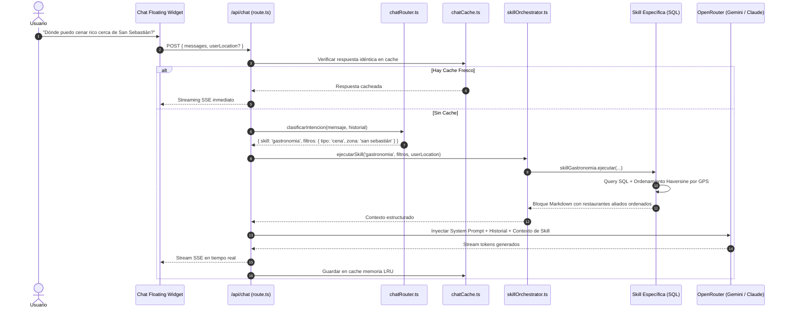

# 📚 MANUAL COMPLETO: ARQUITECTURA Y FUNCIONAMIENTO DEL CHATBOT

Bienvenido a la documentación exhaustiva del Chatbot de **Agenda Cultural Loja** (y su modelo base para **Agenda Turística Loja** y **Qué Comer en Loja**).

---

## 🧭 1. Resumen Ejecutivo y Filosofía del Sistema

El bot opera bajo una arquitectura de **dos niveles**:

1. **Nivel Conversacional / Identidad (Siempre Activo):**
   - Controlado por el System Prompt principal (`prompt.txt` / [route.ts](file:///d:/Abel%20paginas/agenda%20cultural/software/app/api/chat/route.ts)).
   - Maneja el tono lojano cálido, reglas de venta ("vender sin parecer vendedor"), desvíos amables cuando preguntan cosas ajenas a Loja, estructuración de mensajes (máximo 1-2 párrafos) y preguntas de cierre atractivas.
   - **No toca bases de datos innecesariamente**. Si el usuario dice *"hola"*, *"buenos días"*, *"gracias"*, o hace una pregunta genérica, responde de forma rápida usando la memoria de contexto sin gastar consultas SQL ni sobrecargar el LLM.

2. **Nivel de Skills de Datos (Activación Condicional por Intención):**
   - Cuando el usuario formula una intención sobre **Eventos**, **Hospedaje**, **Restaurantes/Cafeterías**, o **Turismo/Rutas**, el clasificador de intenciones ([chatRouter.ts](file:///d:/Abel%20paginas/agenda%20cultural/software/lib/chat/chatRouter.ts)) activa el **Orquestador de Skills** ([skillOrchestrator.ts](file:///d:/Abel%20paginas/agenda%20cultural/software/lib/chat/skills/skillOrchestrator.ts)).
   - Cada Skill sabe exactamente a qué base de datos consultar, qué filtros aplicar (fechas, distancias GPS Haversine, tipos de cocina o alojamiento) y devuelve un bloque de contexto markdown compacto para inyectar al LLM.

---

## 🗄️ 2. Arquitectura de las 4 Bases de Datos Definitivas

Las **4 Bases de Datos MySQL** se encuentran activas y conectadas en los 3 proyectos:

```
                              ┌────────────────────────────────────────┐
                              │           CHATBOT ORCHESTRATOR         │
                              └───────┬─────────┬─────────┬────────────┘
                                      │         │         │            │
                         (CRM/Sesión) │         │ (Hoteles│ (Comida)   │ (Eventos)
                                      ▼         ▼         ▼            ▼
                            ┌─────────────┐   ┌─────────────┐   ┌─────────────┐   ┌─────────────┐
                            │   DB 1      │   │   DB 2      │   │   DB 3      │   │   DB 4      │
                            │ BOTEMPRESAS │   │   AGENDA    │   │  QUE COMER  │   │   AGENDA    │
                            │ (CRM / Hub) │   │  TURÍSTICA  │   │   EN LOJA   │   │  CULTURAL   │
                            │ :44521      │   │ :46132      │   │ :46630      │   │ :44369      │
                            └─────────────┘   └─────────────┘   └─────────────┘   └─────────────┘
```

### Tabla de Configuración de Conexiones

| Dominio | Variable de Entorno | Host / DB | Rol y Responsabilidad |
| :--- | :--- | :--- | :--- |
| **Sesiones / CRM / Leads** | `CHATBOT_DB_URL` | `mysql.us.stackcp.com:44521` (`Botempresas-353039368f96`) | Memoria, historial, prospectos de venta filtrados por `CHATBOT_SITE_ID`. |
| **Eventos Culturales** | `EVENTOS_DB_URL` | `mysql.us.stackcp.com:44369` (`agendaculturalbd-313930d0fa`) | Cartelera aprobada, fechas, recintos y categorías ([skillEventos.ts](file:///d:/Abel%20paginas/agenda%20cultural/software/lib/chat/skills/skillEventos.ts)). |
| **Hospedaje y Atractivos** | `TURISTICA_DB_URL` | `mysql.us.stackcp.com:46132` (`agendatursticdinamic-31383916da`) | Hoteles, hostales, habitaciones/precios y rutas cantonales ([skillHospedaje.ts](file:///d:/Abel%20paginas/agenda%20cultural/software/lib/chat/skills/skillHospedaje.ts), [skillTurismo.ts](file:///d:/Abel%20paginas/agenda%20cultural/software/lib/chat/skills/skillTurismo.ts)). |
| **Gastronomía y Cafeterías** | `GASTRONOMIA_DB_URL`| `mysql.us.stackcp.com:46630` (`quecomerlojadinamic-313931562a`) | Restaurantes, cafeterías y especialidades típicas ([skillGastronomia.ts](file:///d:/Abel%20paginas/agenda%20cultural/software/lib/chat/skills/skillGastronomia.ts)). |

---

## ⚡ 3. El Flujo de Ejecución Paso a Paso

Cuando el usuario envía un mensaje a `/api/chat`:



---

## 🧩 4. Catálogo Detallado de Skills

### 4.1. Skill General / Conversacional (`System Prompt`)
- **Archivo:** [app/api/chat/route.ts](file:///d:/Abel%20paginas/agenda%20cultural/software/app/api/chat/route.ts)
- **Activación:** 100% de los turnos.
- **Responsabilidad:** Garantiza la personalidad del asistente, controla que las respuestas sean concisas (1-2 párrafos), aplica las reglas éticas de venta recomendando aliados oficiales primero con llamada a la acción y enlaces amigables.

### 4.2. Skill Eventos (`skillEventos.ts`)
- **Archivo:** [lib/chat/skills/skillEventos.ts](file:///d:/Abel%20paginas/agenda%20cultural/software/lib/chat/skills/skillEventos.ts)
- **Base de Datos:** `DATABASE_URL` (Agenda Cultural).
- **Filtros Soportados:**
  - `hoy`: Eventos del día en curso.
  - `semana`: Eventos de los próximos 7 días.
  - `fin_de_semana`: Eventos de viernes a domingo próximos.
  - `mes`: Eventos de los próximos 30 días.
  - `pasados`: Archivo histórico si el usuario pregunta qué hubo antes.
  - `busqueda`: Coincidencia por texto en título, descripción o venue.
- **Salida:** Lista ordenada cronológicamente con título, fecha/hora, lugar, organizador y si requiere entrada.

### 4.3. Skill Hospedaje (`skillHospedaje.ts`)
- **Archivo:** [lib/chat/skills/skillHospedaje.ts](file:///d:/Abel%20paginas/agenda%20cultural/software/lib/chat/skills/skillHospedaje.ts)
- **Base de Datos:** `CHATBOT_DB_URL` (`aliados` donde `tipo IN ('hotel', 'hostal', 'hosteria', 'glamping', 'alojamiento')`).
- **Filtros Soportados:** Cantón/zona, tipo de hospedaje, rango de precio, geolocalización GPS del usuario (calcula distancia en km usando fórmula Haversine).
- **Salida:** Bloque con nombre del hotel, servicios (WiFi, desayuno, parqueadero), contacto y ubicación exacta.

### 4.4. Skill Gastronomía (`skillGastronomia.ts`)
- **Archivo:** [lib/chat/skills/skillGastronomia.ts](file:///d:/Abel%20paginas/agenda%20cultural/software/lib/chat/skills/skillGastronomia.ts)
- **Base de Datos:** `CHATBOT_DB_URL` (`aliados` donde `tipo IN ('restaurante', 'cafeteria', 'bar', 'hueca')`).
- **Filtros Soportados:** Tipo de comida (típica lojana, café de especialidad, gourmet, rápida), cantón, coordenadas GPS.
- **Salida:** Bloque destacando platos insignia (tamales, humitas, cecina, café de altura), horarios y dirección.

### 4.5. Skill Turismo Cantonal (`skillTurismo.ts`)
- **Archivo:** [lib/chat/skills/skillTurismo.ts](file:///d:/Abel%20paginas/agenda%20cultural/software/lib/chat/skills/skillTurismo.ts)
- **Base de Datos:** `CHATBOT_DB_URL` (`atractivos_cantonales`).
- **Filtros Soportados:** Cantón (Vilcabamba, Catamayo, Saraguro, Loja centro, etc.), tipo de turismo (senderismo, cascadas, miradores, patrimonio cultural).
- **Salida:** Reseña del atractivo, cómo llegar, clima/recomendaciones de calzado y tiempo estimado de visita.

### 4.6. Skill Planifica tu Visita (`skillPlanVisita.ts`)
- **Archivo:** [lib/chat/skills/skillPlanVisita.ts](file:///d:/Abel%20paginas/agenda%20cultural/software/lib/chat/skills/skillPlanVisita.ts)
- **Activación:** Cuando el usuario pide itinerarios completos (ej: *"Voy a Loja 3 días con mi familia, qué me recomiendas?"*).
- **Comportamiento:** Dispara consultas concurrentes con `Promise.allSettled` a **Eventos + Hospedaje + Gastronomía + Turismo** y entrega un itinerario holístico sin llamadas redundantes.

---

## 🚀 5. Cómo Migrar a Otro Proyecto en 3 Pasos

Para llevar este bot idéntico a **Agenda Turística Loja** o **Qué Comer en Loja**:

1. **Copiar la carpeta `bot/paquete-migracion`** en la raíz del nuevo proyecto.
2. **Instalar dependencias:**
   ```bash
   npm install @prisma/client mysql2 lru-cache
   ```
3. **Variables en `.env.local`:**
   Configurar las variables de conexión según corresponda (ej. `DATABASE_URL` y `CHATBOT_DB_URL`).
4. **Adaptar el Contexto Principal:**
   En `app/api/chat/route.ts` o `prompt.txt`, simplemente ajustar la primera línea de identidad:
   - Para Agenda Turística: *"Eres el Asistente Oficial de Turismo de Loja..."*
   - Para Qué Comer en Loja: *"Eres el Guía Gastronómico Oficial de Loja..."*
   **¡Todas las skills, routers y conexiones seguirán funcionando exactamente igual sin escribir código nuevo!**
